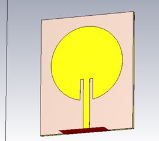
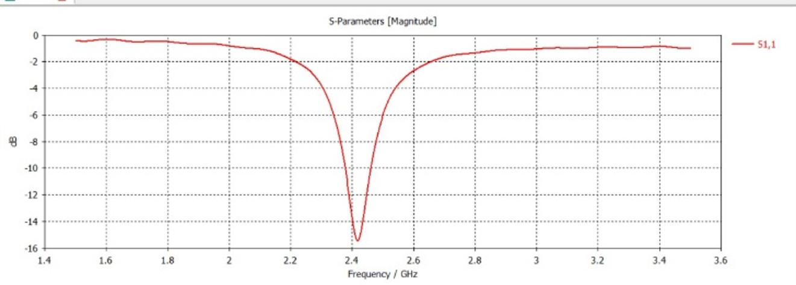
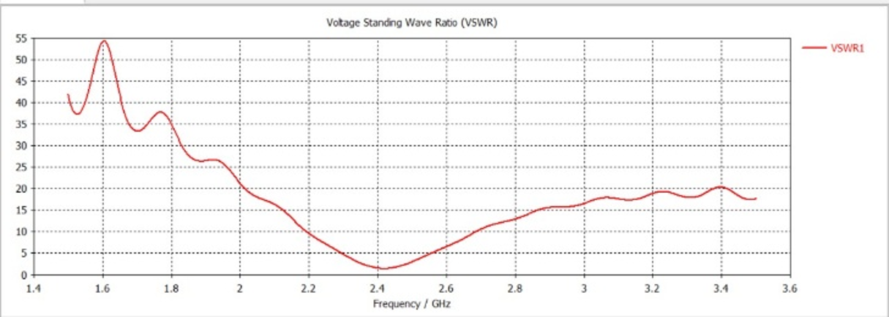
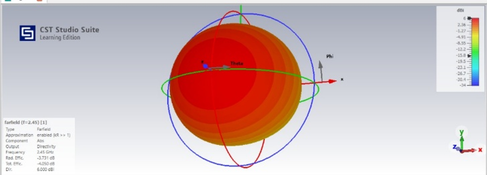
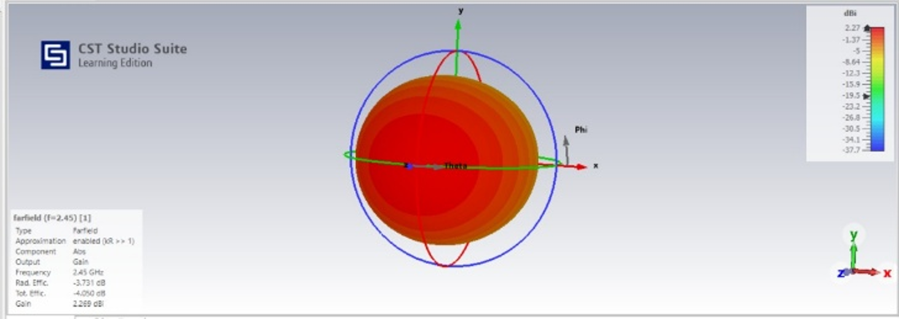
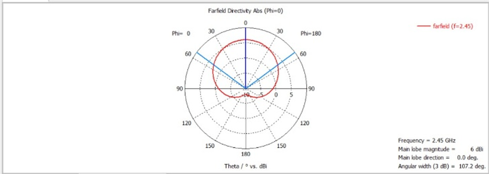
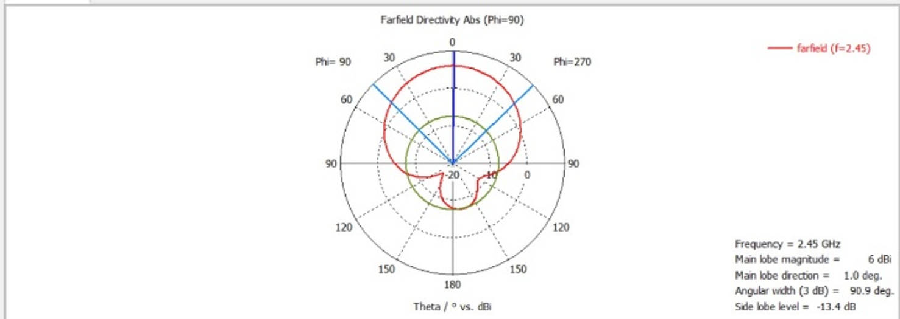
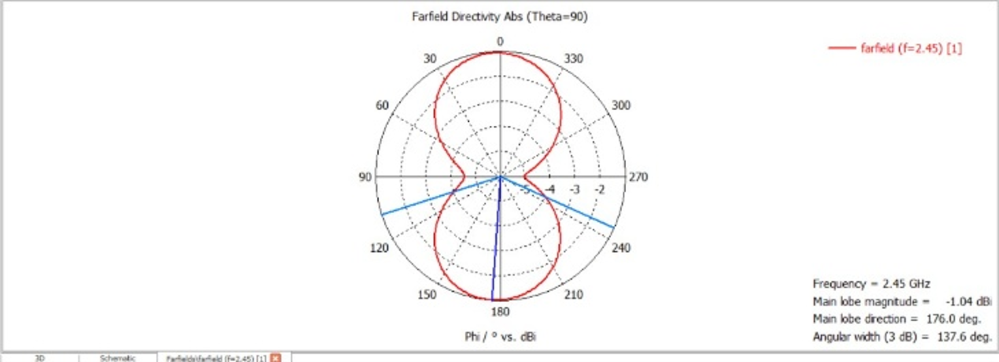

# Circular Microstrip Patch Antenna for RFID at 2.45 GHz

Design and simulation of a compact, inset-fed circular microstrip patch antenna for RFID applications in the 2.45 GHz ISM band, using **CST Studio Suite**.

## Overview

The antenna is one of the main factors deciding an RFID system's read range, bandwidth and reliability. Circular microstrip patches offer a small footprint, low cost, easy integration with circuits and good impedance matching, which makes them a strong fit for 2.45 GHz RFID readers and tags.

## Design



| Parameter | Value |
|---|---|
| Target frequency | 2.45 GHz |
| Substrate | FR4 (lossy) |
| Dielectric constant (εr) | 4.3 |
| Loss tangent (tan δ) | 0.02 |
| Substrate thickness (h) | 1.6 mm |
| Patch radius | 17.35 mm |
| Feed | 50 Ω inset microstrip line |
| Solver | Transient (broadband), 1.5 – 3.5 GHz |

The patch radius was calculated from the standard circular microstrip patch design equations, then refined in simulation.

## Results

| Metric | Result |
|---|---|
| Resonant frequency | ≈ 2.42 GHz |
| Minimum S11 | ≈ –15.5 dB |
| –10 dB bandwidth | ≈ 2.38 – 2.47 GHz |
| Minimum VSWR | ≈ 1.4 |
| Gain | 2.27 dBi |
| Directivity | 6.0 dBi |
| 3 dB beamwidth | 107.2° (φ = 0°), 90.9° (φ = 90°) |
| Side lobe level (φ = 90°) | –13.4 dB |
| Radiation efficiency | –3.73 dB |

### Return loss (S11)



S11 dips to about –15.5 dB near 2.42 GHz and stays below the –10 dB benchmark from roughly 2.38 to 2.47 GHz, so the 2.45 GHz RFID frequency falls inside the matched band.

### VSWR



The VSWR reaches its minimum at resonance, showing good impedance matching to the 50 Ω feed. Away from resonance the mismatch rises sharply, as expected for a narrowband patch.

### Radiation pattern








The antenna radiates a wide broadside beam perpendicular to the patch, with 6 dBi directivity and 3 dB beamwidths of about 107° and 91° in the two principal planes. The wide beam gives broad coverage for reader–tag communication.

### Comparison with other RFID antennas

| Reference | Application | Frequency | Substrate / material | Reported performance |
|---|---|---|---|---|
| Islam et al., *Sensors*, 2018 | Flexible UHF tag | Universal UHF RFID band | Photo paper, inkjet-printed silver | Read range ≈ 4.57 m (15 ft) |
| Vena et al., IEEE RFID, 2013 | Wearable chipless tag | 3 – 6 GHz | Cotton textile, sewn conductive thread | Est. read range 1.68 m |
| Liu et al., *IEEE TAP*, 2015 | Handheld reader | 0.92 / 2.45 GHz | — | Dual-band, circularly polarized |
| Romputtal & Phongcharoenpanich, *IEEE Access*, 2019 | Integrated reader | 13.56 MHz, 920–925 MHz, 2.45 GHz | — | NFC + dual-band RFID in one antenna |
| **This work** | **2.45 GHz RFID** | **2.38 – 2.47 GHz (–10 dB)** | **FR4** | **Gain 2.27 dBi, directivity 6.0 dBi** |

The designs target different bands and applications, so the comparison is qualitative. Full references are in the report.

## Repository Contents

```
├── images/     Geometry, S11, VSWR and radiation pattern plots
└── report.pdf  Full project report
```

## Future Work

- Fine-tune the patch radius to shift the resonance from 2.42 GHz to exactly 2.45 GHz.
- Fabricate the antenna on FR4 and measure S11 and the radiation pattern with a vector network analyzer to compare against simulation.

## Author

**V Shruthi Shri**
